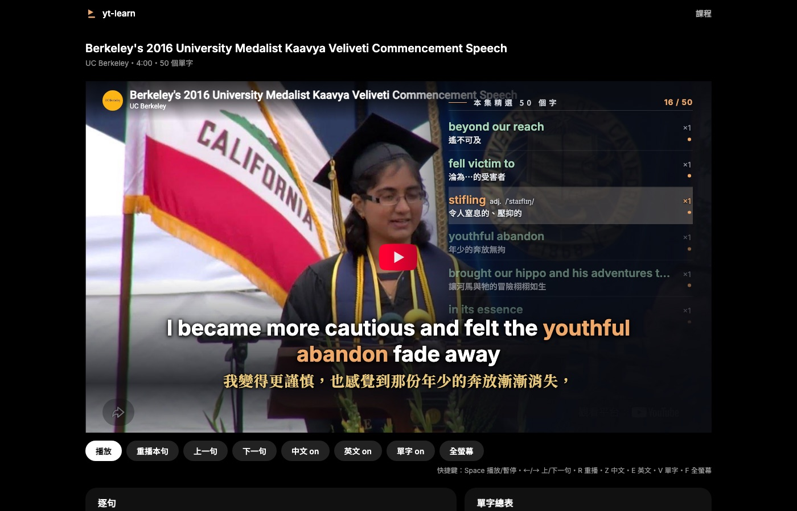
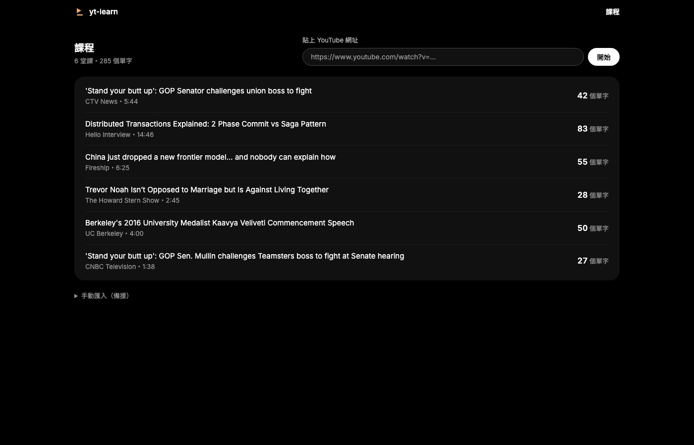
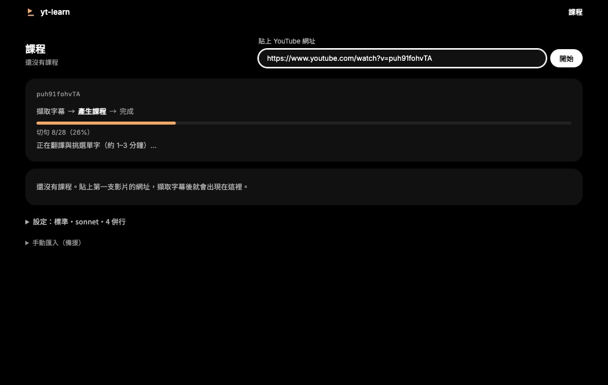
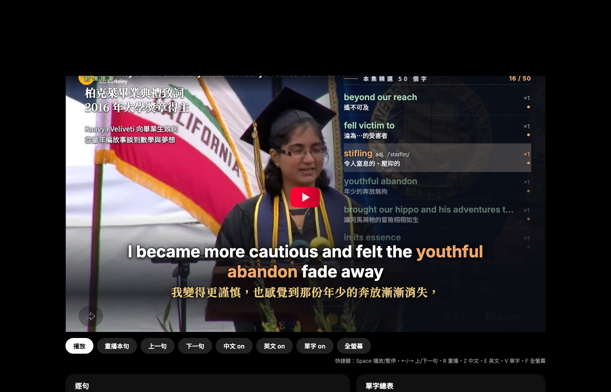
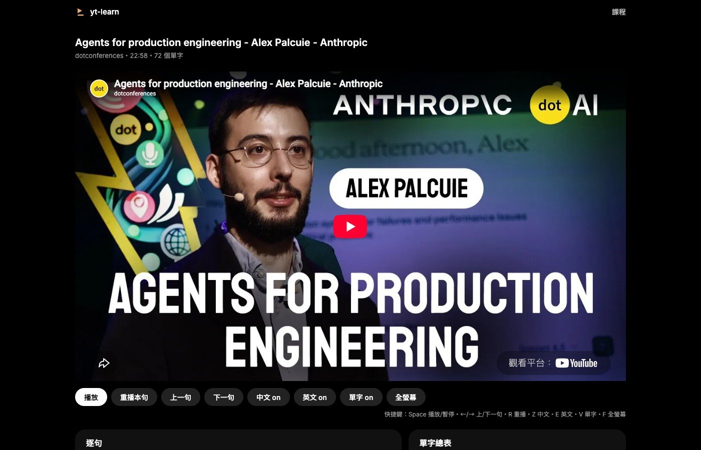
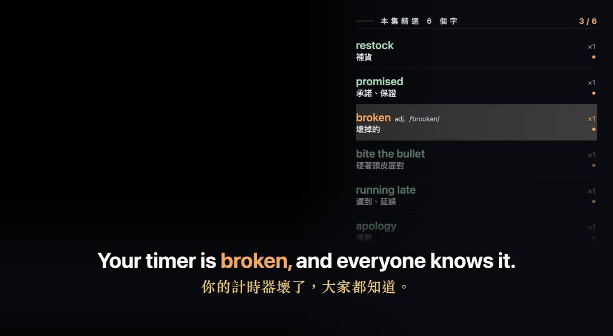

**yt-learn** turns a YouTube video into an English lesson: bilingual EN/繁中 subtitles, a key-vocabulary panel and a recap card, overlaid on the YouTube player by a Chrome extension (the same overlay also works on Udemy, Netflix and HelloInterview). Translation and vocabulary picking go through either your already logged-in `claude` or `codex` CLI (no API key needed) or, if you prefer, your own Anthropic or OpenAI API key; with a key the app shows an estimated cost per lesson and can enforce a monthly budget. Everything runs locally on 127.0.0.1:8765.

Requirements: Python >= 3.11, Node 22, Chrome, and either a logged-in `claude` or `codex` CLI or an Anthropic/OpenAI API key.

Personal, local-only tool; see [Terms-of-service & scope](#terms-of-service--scope) below.

---

# yt-learn

把一支 YouTube 影片變成一堂英文課：中英雙字幕、右側「本集精選單字」面板、開場「前情提要」卡、片尾總複習格。全部在本機跑，給自己學英文用。同一套疊層也能蓋在 Udemy 講座、Netflix 影集與 HelloInterview 課程上（見「支援站點」）。

版面是向 [MJ English](https://www.youtube.com/@mjenglish) 頻道的剪輯方式致敬：講者靠左、右側暗區列出本集單字、當前單字在字幕裡標橘、句句都有中譯。這個專案不剪影片，而是把同樣的版面疊在 YouTube 播放器上，任何有字幕的影片都能這樣看。有兩種看法：在 youtube.com 影片頁按擴充功能圖示，課程直接疊在 YouTube 自己的播放器上；或開本機的播放器頁面。



## 它會做什麼

1. **擷取字幕**：在 YouTube 分頁按一下擴充功能圖示（或在首頁貼網址），擴充會抓 YouTube 自帶的逐字時間戳字幕。
2. **產生課程**：本機 pipeline 切句、翻成繁體中文、挑出值得記的單字片語、寫一張背景卡。語言模型可以透過你已登入的 CLI 呼叫（預設 Claude，也可用 Codex，不需要 API key），也可以改用你自己的 Anthropic 或 OpenAI API key。
3. **播放學習**：字幕逐句顯示並標出當前單字；單字面板隨影片推進平滑捲動；開播十秒內左上角浮出前情提要。在 YouTube 頁面上是擴充功能把這些疊在播放器裡（全螢幕、劇院模式都在）；本機播放器多一個片尾總複習格與逐字稿。

| 首頁：貼網址、看進度、挑一堂課 | 產課中的進度卡 |
| --- | --- |
|  |  |

| 前情提要卡（開播後十秒淡出） | 播放頁全貌 |
| --- | --- |
|  |  |

## 需要什麼

- macOS 或 Linux，Python 3.11 以上（只用標準庫）。
- Chrome，並以「載入未封裝項目」安裝 `extension/`（見 `extension/README.md`）。沒有擴充時可用 `bookmarklet.js` 加首頁的手動匯入。
- 語言模型來源擇一：已登入的 LLM CLI（`claude`〔預設〕或 `codex`），或一把 Anthropic／OpenAI 的 API key（見「設定」與「費用」）。
- 影片本身要有字幕軌（YouTube 的自動字幕或上傳字幕都可以；Udemy、Netflix 與 HelloInterview 要有英文字幕）。
- Node 22 與 `uv` 只有跑測試才需要。

## 支援站點

| 站點 | 怎麼開始 | 看的地方 | 字幕來源 |
| --- | --- | --- | --- |
| YouTube | 影片頁按圖示，或在首頁貼網址 | YouTube 播放器上的疊層，或本機播放器 | 播放器自己發出的 timedtext 請求 |
| Udemy | 已購買課程的講座頁按圖示 | Udemy 播放器上的疊層 | 講座的英文字幕檔（VTT） |
| Netflix | 先啟用一次（見下），播放頁按圖示 | Netflix 播放器上的疊層 | 該集的英文字幕軌（TTML） |
| HelloInterview | 已登入帳號的 learn 課程頁按圖示 | HelloInterview 播放器上的疊層 | 影片自帶的英文字幕軌（VTT） |

四站共用同一個疊層引擎與同一組快捷鍵。Udemy、Netflix 與 HelloInterview 的課程在本機頁面可以看逐字稿與單字複習，但沒有播放器；要播放請從課程頁的連結回原講座／原集。

**Netflix 預設關閉，要自己開。** Netflix 的字幕清單只存在播放頁解開的 manifest 裡，所以擴充需要一個在頁面載入最早期包住 `JSON.parse` 的唯讀 hook，以及 `https://www.netflix.com/*` 的網站權限。第一次在 `https://www.netflix.com/watch/<id>` 按圖示會開啟擴充自己的啟用頁：按「啟用並重新載入這個分頁」、在 Chrome 的授權框選「允許」，分頁會自動重新載入；也可以在圖示上按右鍵勾選「在 Netflix 啟用」。之後在播放頁按圖示：第一次會在播放器左下角出現「擷取字幕 → 產生課程 x% → 完成」的 pill，課程做好後疊層自動蓋上並隱藏 Netflix 自己的字幕；再按一次是開／關疊層。換集時，新一集已有課程就直接換上；沒有課程就收起來，要再按一次圖示才會擷取。hook 只讀 manifest 裡的字幕清單，不改任何請求、不記錄網址；只有你按圖示時才會抓那一集的英文字幕檔（有官方繁中軌時會一併抓來給翻譯當參考）。關閉：圖示右鍵取消勾選，擴充會收起疊層、註銷腳本並撤回網站權限；在 `chrome://extensions` 收回權限也等於關閉。右鍵選單的「診斷目前的 Netflix 分頁」會列出 hook 狀態、字幕軌與一次測試抓取的結果，出問題時先看這個。



## 開始用

```bash
cd yt-learn
python3 server.py            # http://127.0.0.1:8765
```

然後二選一：

- 在 YouTube 影片頁（或 Udemy 講座頁、已啟用的 Netflix 播放頁、HelloInterview 的 learn 課程頁）按擴充功能圖示，課程直接疊在網站自己的播放器上（雙語字幕、橘色單字、右側單字面板、前情提要卡），再按一次關掉。還沒有課程的影片，播放器左下角會顯示「擷取字幕 → 產生課程 x% → 完成」，完成後自動疊上。疊層快捷鍵：Z 中文・E 英文・V 單字面板・R 重播本句・[ ] 上一句／下一句。點字幕裡的任何一個字，影片暫停並在旁邊的小視窗開劍橋英漢字典（同一個視窗重複使用）。使用時請把「沉浸式翻譯」在 YouTube 關掉；第一次用請在 chrome://extensions 重新載入擴充功能；已開著的 YouTube 分頁不必重新整理。
- 或打開 <http://127.0.0.1:8765>，貼上影片網址，按「開始」。

進度卡會顯示「擷取字幕 → 產生課程 → 完成」；產課階段有切句進度。切句的 chunk 彼此獨立，預設同時跑 4 個（環境變數 `YTLEARN_WORKERS` 可調，設 1 就是逐一跑）；Codex 約慢兩倍半，切句較長、挑的單字較少但偏片語。

也可以直接用指令產課（字幕檔已在 `data/raw/<videoId>.json` 時）：

```bash
python3 -m pipeline.build <videoId>                    # 預設 Claude
python3 -m pipeline.build <videoId> --provider codex   # 用 Codex CLI
YTLEARN_PROVIDER=codex python3 server.py               # 讓 server 啟動的產課都用 Codex
python3 -m pipeline.build <videoId> --model claude-opus-5-5 --effort high   # 指令列參數優先於一切
```

### 設定

首頁課程列表下方的「設定」可以選產課用的語言模型來源、模型、effort（思考強度）與切句併行數（1–8），也有三個一鍵預設：**快**（Haiku、low、8 併行）最快也最省，中譯與挑字會粗一點；**標準**（Sonnet、不指定 effort、4 併行）就是原本的預設；**細緻**（Opus、high、4 併行）最慢也最貴，翻譯與挑字最好。套用預設後三個欄位仍可個別改，按「儲存」才生效。設定存在 `data/settings.json`（不進 git）；檔案裡有的值優先，沒有的才看環境變數 `YTLEARN_MODEL`、`YTLEARN_EFFORT`、`YTLEARN_WORKERS`，指令列參數又優先於兩者。用 CLI 來源時，server 啟動的產課只套用檔案裡有的值、其餘照原樣繼承環境變數，所以原本用環境變數的做法照樣能用，連設定頁選不到的值（例如 `YTLEARN_MODEL=opus`、`YTLEARN_WORKERS=12`）也一樣；用 API 來源時，產課用的是設定頁顯示的那一組值，設定頁表達不了的環境變數值會被忽略、改用預設。模型與 effort 對 Claude CLI 與兩個 API 來源都有效，只有 Codex CLI 不同：模型照 Codex 自己的設定，effort 以 `model_reasoning_effort` 傳、最高到 high；併行數所有來源都適用。設定套用在之後開始的產課，正在跑的那支不受影響。effort 不同的回覆分開快取，換回原本的 effort 會重用舊快取。在工具列的擴充功能圖示上按右鍵，有「打開 yt-learn 首頁」與「設定」兩個入口。

**語言模型來源。** 設定裡的「語言模型來源」有四個選項：「Claude CLI（本機登入）」（預設）、「Codex CLI（本機登入）」、「Anthropic API key」、「OpenAI API key」。選到 API 來源時會出現 key 欄位：貼上 key 後按「測試連線」，成功就立刻存進本機 `data/keys.json`（權限 0600，不進 git），不必另外按「儲存」；之後頁面只看得到最後四碼，可以「更換」或「移除」。也可以不貼，改設環境變數 `ANTHROPIC_API_KEY` 或 `OPENAI_API_KEY`；兩邊都有時 `data/keys.json` 優先，來自環境變數的 key 要移除得改環境變數。測試連線成功時會順便抓回這把 key 能用的模型清單，存在 `data/models.json`：Anthropic 只列 `claude-` 開頭的模型；OpenAI 只列帳號可用的推理模型（`gpt-5`／`gpt-6`、`o3`／`o4` 系列，濾掉 realtime、audio、image、embedding 等），這只是篩出「可能能用」的清單，實際相容與否以產課結果為準。環境變數 `YTLEARN_PROVIDER` 也接受 `anthropic-api`、`openai-api`（`claude`、`codex` 仍是 `claude-cli`、`codex-cli` 的別名）。

**設定在你按下產課的那一刻綁定該次產課。** 之後再改設定，不影響已經開始或排隊中的那一次。

**key 的去向。** key 不會出現在網頁回應、log、指令列參數、進度檔、課程檔與帳本，錯誤訊息裡也會遮掉。API 來源的產課子程序只拿到你選定的那一家的 key（另一家的環境變數會被移除）；CLI 來源則原樣繼承目前的環境變數，不做任何處理。用 API 時，字幕文字會直接送到 Anthropic 或 OpenAI，這是 CLI 之外多出來的一條資料出口。

**每月上限。** 設定的「每月上限（美元）」留空代表不限。上限只算 API 來源，CLI 走訂閱額度、不計入。帳本合計到 80% 時，新增產課會顯示提醒；到 100% 時，首頁新增會回 HTTP 402，進度卡位置出現「這次仍要跑」按鈕，按了才會開始（只跑這一次，不會記住）。在 YouTube 頁按擴充功能圖示被擋時，播放器左下角的 pill 會提示到首頁選擇仍要跑；Udemy、Netflix、HelloInterview 則要先到首頁調高或關閉上限再重試，擴充功能本身不能繞過。上限只看帳本裡**已結束**的產課，**不含進行中與排隊中的**，所以同時排很多支可能超出一點；正在跑的產課不會被中斷。

## 費用

費用有兩種算法，取決於「設定」選的語言模型來源。

### CLI 來源（訂閱額度）

預設的 Claude Sonnet 5.5（`pipeline/build.py` 的 `DEFAULT_MODEL`）透過已登入的 `claude` CLI 呼叫，吃的是 Claude 訂閱的用量額度，不是 API 帳單。下面是以 API 牌價（輸入 $2、輸出 $10 每百萬 token）換算的單次產課估計。輸入用真實 prompt 估算；輸出用課程檔還原一次產課的回覆估算（快取裡可能有多次產課的回覆，不直接加總）。另外每次 `claude -p` 呼叫都有約 3.6k token 的 CLI 固定開銷（多半是寫入 prompt cache，以 1.25 倍、每百萬 $2.5 計）：

| 影片長度 | 呼叫次數 | 輸入（prompt） | CLI 固定開銷 | 輸出 | 約略費用 |
| --- | --- | --- | --- | --- | --- |
| 6 分 | 12 | 13k | 43k | 8k | $0.21 |
| 22 分 | 30 | 32k | 108k | 18k | $0.52 |
| 40 分 | 56 | 63k | 202k | 35k | $0.98 |

經驗法則：一分鐘影片約 2.5 到 3.5 美分，一支 20 分鐘的演講約半美元。早期版本的每次呼叫還會載入本機的 MCP 伺服器、hooks 與使用者設定，固定開銷約 30k token；現在 `claude -p` 帶 `--strict-mcp-config --setting-sources ""`，降到約 3.6k。重跑同一支影片幾乎免費，回覆都快取在 `data/cache/`，只有 prompt 版本變了才會重新呼叫。

還沒做的省錢空間：每個切句 chunk 都是獨立的 `claude -p` 程序，上面的固定開銷與系統提示每次重送，是輸入的大宗，chunk 切大一點、呼叫少一點就省；輸出裡一半是把英文原句抄回來，schema 改成只回切點與中譯可砍近半。

### API 來源（按 token 計費，本機估算）

選 Anthropic 或 OpenAI 的 API key 時，是照 token 向帳戶計費，yt-learn 在本機把每次回應回報的用量累加並換算成美元：

- **進度卡**：產課中顯示目前累計的「約 $x・y tokens」；完成卡與課程列表的每一堂課也顯示費用。課程檔裡有 `usage`（input、cacheRead、cacheWrite、output 的 token 數）與 `costUsd`。模型不在牌價表裡時顯示「牌價未知」，帳本記 token、金額為 `null`，不會擋產課。
- **帳本**：每支產課結束後在 `data/usage.jsonl`（不進 git）追加一行，記時間、影片、來源、模型、token、`costUsd` 與狀態。失敗或中途停止的產課那一行標 `partial: true`；server 當掉時留下的孤兒產課，會在下次啟動時以 `state: "orphan"` 補記。首頁會顯示本月 API 合計與上限的使用率，CLI 的等值金額另列、不計入上限。
- **牌價表**：`pipeline/prices.json`，每個模型一列：`input`、`output`、`cacheRead`、`cacheWrite`（每百萬 token 美元）、`source`（牌價網址）與 `asOf`（抄錄日期）。牌價會變，所以這是**估算，不是帳單**，實際金額以 Anthropic／OpenAI 後台為準。新模型或牌價更新時自己改這個檔（`cacheRead`／`cacheWrite` 填 `null` 代表照 `input` 計），不用動程式。OpenAI 的快取寫入 token 怎麼計入 input 沒有官方文件證實，程式假設它包含在 input 內，屬估算。
- 回覆都快取在 `data/cache/`。Anthropic API 與 Claude CLI 對同一個模型、prompt 與 effort 共用快取，所以用 API 產過的影片切回 `claude-cli` 重產，不會再呼叫（`llm_calls=0`）；OpenAI 與 Codex 各有自己的快取。

## 快捷鍵

- 疊層（YouTube、Udemy、Netflix、HelloInterview 相同）：Z 中文・E 英文・V 單字面板・R 重播本句・[ ] 上一句／下一句。網站自己的快捷鍵不受影響（YouTube 的 Space、← →、F、C、K、J、L、M；Netflix 的 Space、← →、F、M、S、數字鍵）。
- 本機播放器：Space 播放／暫停・← → 上一句／下一句・R 重播本句・Z 中文・E 英文・V 單字面板・F 全螢幕。中文輸入法開著也能用。
- 滑鼠（兩種播放器都一樣）：點字幕裡的任何一個字，影片暫停並在旁邊的小視窗開劍橋英漢字典；當前單字（橘色）會查整個詞。右側單字面板照舊是點一下跳到那一句。

## 專案結構

```
extension/   Chrome MV3 擴充：在 YouTube、Udemy、Netflix（選擇性開啟）與 HelloInterview 分頁擷取字幕送到本機 server，並把課程疊在播放器上
server.py    標準庫 HTTP server：靜態網頁、/ingest、/add、/jobs、/settings、/keys、/usage、產課佇列
pipeline/    words（字詞正規化）→ chunk → segment（切句翻譯）→ vocab（挑字）→ intro（前情提要）→ build
             settings（來源、模型、上限）、keys（API key）、cost 與 prices.json（牌價換算）、usage（用量帳本）
web/         播放器：index.html、app.js、style.css、timing.js（純函式）、dict.js（查字典）、intro.js（前情提要）、settings.js（設定）、progress.js（進度）、handshake.js（與擴充功能握手）、lesson-source.js（課程來源）、ytid.js（網址解析）
data/        raw/（字幕）、lessons/（課程 JSON）、cache/（LLM 回覆）、jobs/（build log）、keys.json（API key，0600）、usage.jsonl（用量帳本）、models.json（模型清單快取）
tests/       pytest（pipeline、server）與 node --test（web 純函式、擴充功能的純函式與 worker 訊息）
docs/        設計與計畫（superpowers/plans）、參考版面觀察、截圖
```

```bash
uv run --with pytest pytest -q                   # pipeline + server
node --test tests/web/                           # 播放器與擴充功能的純函式
```

## 已知限制

- 自動字幕的品質決定切句與單字的品質；沒有字幕軌的影片做不了。
- CLI 來源的速度取決於你的帳號與模型；API 來源的金額只是本機估算，不是帳單；回覆會快取在 `data/cache/`，重跑同一支影片很快。
- 兩種疊層都蓋在 YouTube 播放器上（擴充功能蓋在 youtube.com 的播放器，本機播放器蓋在嵌入播放器），只適合個人本機使用，不要公開部署。
- YouTube 條款風險：字幕是重用播放器自己發出的 timedtext 請求取得的，疊層也直接畫在播放器上，這兩件事都可能不符合 YouTube 的服務條款與嵌入規範。請只在自己的電腦上、為自己學習使用，不要拿來散布字幕或課程內容。
- YouTube 疊層與「沉浸式翻譯」這類也在播放器上畫字幕的擴充會重疊，看課時先把它們在 YouTube 關掉。
- 前情提要卡的字數有上限，模型兩次都寫太長時那一堂就沒有卡，其他功能照常。
- Udemy：只支援已購買課程的講座頁（預覽彈窗、Udemy Business 子網域不行），講座要有英文字幕。
- Netflix：沒有英文字幕的片做不了；有廣告的方案尚未支援；Netflix 改版（播放頁、manifest 格式、播放器 API）可能讓 hook 或疊層失效，屆時用右鍵的「診斷」看是哪一段壞了。跳句一律透過播放器自己的 API，不直接改影片時間（那會觸發 Netflix 的 M7375 錯誤）。已經產好的課程不會自動改用之後才抓到的官方繁中字幕，要套用就刪掉 `data/lessons/netflix.<id>.json`（`<id>` 是網址裡的數字，例如 `netflix.81234567.json`），關掉疊層後再按一次圖示重跑。關閉過程若被中斷，網站權限可能留著——無害（關閉狀態下擴充一律不碰 Netflix），再關一次即可。
- HelloInterview：只支援 www.hellointerview.com/learn/ 底下有影片的課程頁；付費內容只在你自己登入的瀏覽器、本機使用；影片與字幕是會過期的簽名網址，擷取失敗時先重新整理頁面，課程裡不保存這些網址。
- 條款：Udemy、Netflix 與 HelloInterview 的字幕都是重現頁面自己會發出的請求取得的，疊層也直接畫在它們的播放器上，這些都可能不符合各站的使用條款。請只在自己的電腦上、用自己的帳號、為自己學習使用，不要散布字幕或課程內容；本專案的測試與截圖不含任何這些站的字幕內容。

## Terms-of-service & scope

- Personal use only. This is a personal, local-only tool: run it on your own computer, with your own accounts, for your own learning. Do not deploy it publicly.
- Subtitles are obtained by reproducing requests the page itself already makes (for YouTube, the player's own timedtext request), and the overlay is drawn directly on top of each site's player. Both may not comply with the terms of service of YouTube, Udemy, Netflix or HelloInterview, or with YouTube's embedding rules.
- Do not redistribute subtitles or lesson content from these sites. The project's tests and screenshots contain no subtitle content from Udemy, Netflix or HelloInterview.
- Netflix support is opt-in and off by default; you enable it explicitly and grant the site permission yourself.
- Udemy: purchased courses only. HelloInterview: paid content is used only in your own logged-in browser, locally. Videos and captions there use expiring signed URLs, and lessons do not store those URLs.
- Other limits: subtitle quality determines segmentation and vocabulary quality, and videos without a subtitle track cannot be processed. The YouTube overlay can collide with other subtitle-drawing extensions such as Immersive Translate, so turn those off on YouTube.

## 素材出處

截圖裡的影片畫面來自 dotconferences 上傳的〈Agents for production engineering - Alex Palcuie - Anthropic〉（<https://www.youtube.com/watch?v=puh91fohvTA>），YouTube 標示為「創用 CC 姓名標示」授權（CC BY）。播放器本身只嵌入 YouTube 播放器，不複製任何影片內容。Netflix 的截圖只保留疊層介面：影片區遮黑，字幕與單字都是為截圖自己寫的示範課程，不是任何影集的內容。

## 開發紀錄

每個功能都先寫設計與計畫、交給 Codex 審查，再分任務實作與審查；計畫與量測結果在 `docs/superpowers/plans/`，參考影片的版面觀察在 `docs/superpowers/notes/`。

## 授權

MIT，見 [LICENSE](LICENSE)。
