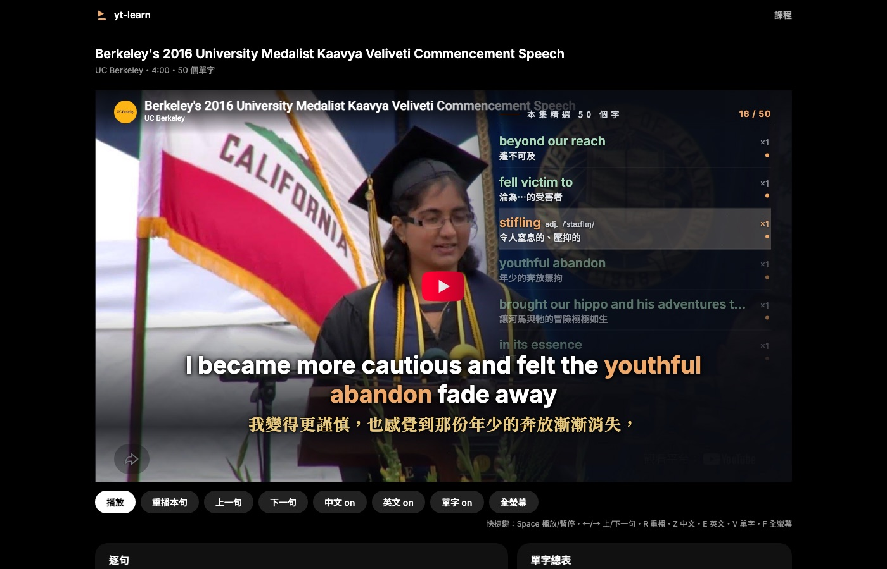
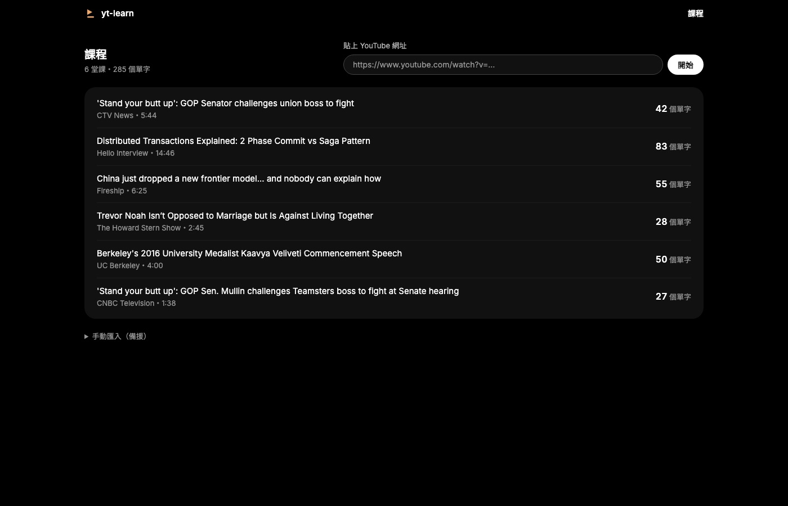
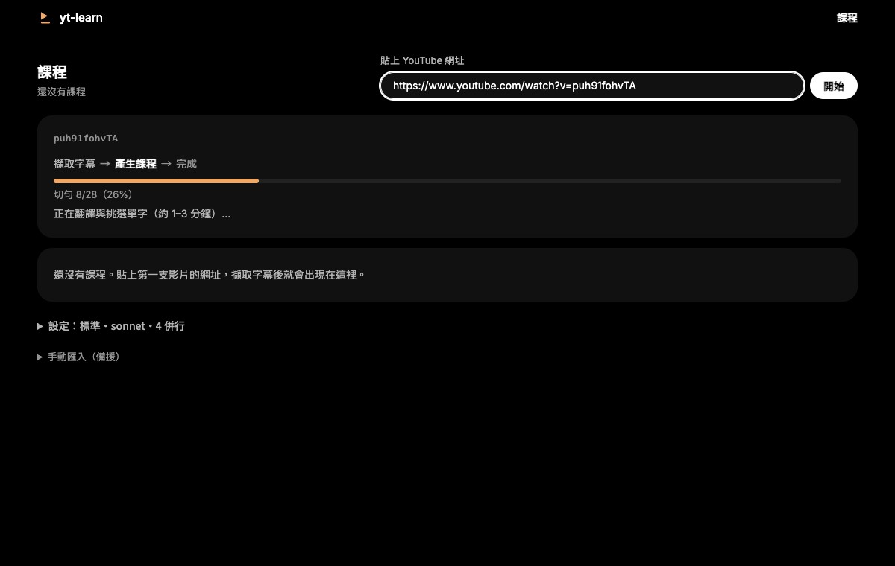
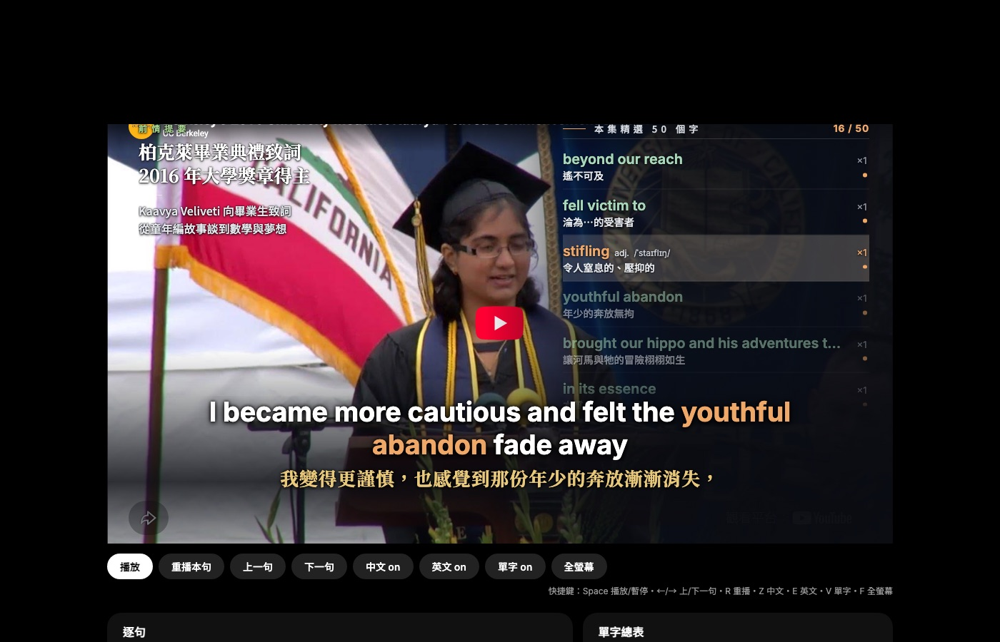
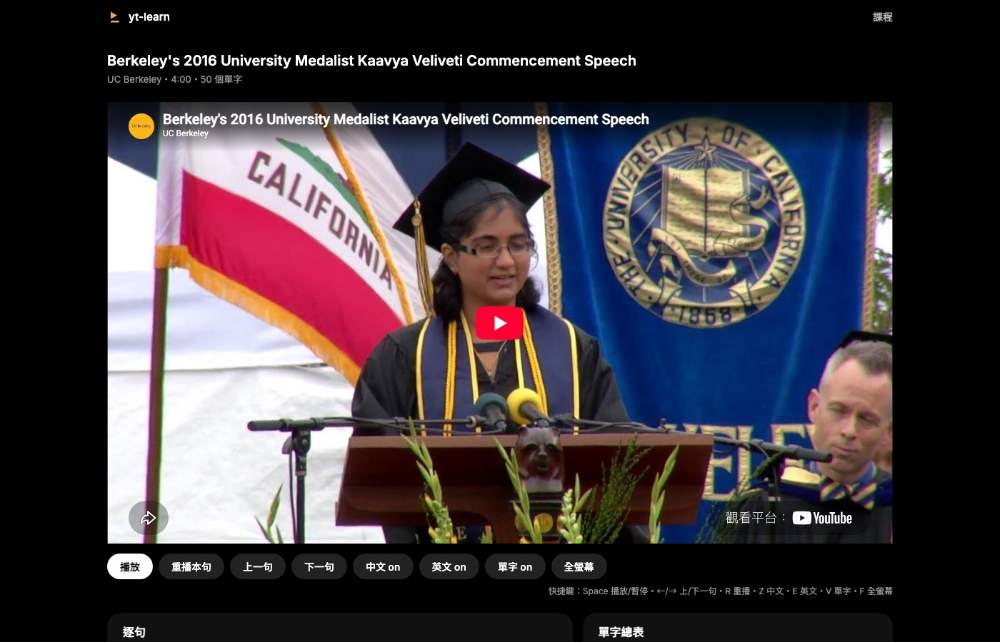

# yt-learn

把一支 YouTube 影片變成一堂英文課：中英雙字幕、右側「本集精選單字」面板、開場「前情提要」卡、片尾總複習格。全部在本機跑，給自己學英文用。

版面是向 [MJ English](https://www.youtube.com/@mjenglish) 頻道的剪輯方式致敬：講者靠左、右側暗區列出本集單字、當前單字在字幕裡標橘、句句都有中譯。這個專案不剪影片，而是把同樣的版面疊在 YouTube 播放器上，任何有字幕的影片都能這樣看。



## 它會做什麼

1. **擷取字幕**：在 YouTube 分頁按一下擴充功能圖示（或在首頁貼網址），擴充會抓 YouTube 自帶的逐字時間戳字幕。
2. **產生課程**：本機 pipeline 切句、翻成繁體中文、挑出值得記的單字片語、寫一張背景卡。語言模型透過你已登入的 CLI 呼叫（預設 Claude，也可用 Codex），不需要 API key。
3. **播放學習**：靜態網頁播放器。字幕逐句顯示並標出當前單字；單字面板隨影片推進平滑捲動；開播十秒內左上角浮出前情提要；片尾進入總複習。

| 首頁：貼網址、看進度、挑一堂課 | 產課中的進度卡 |
| --- | --- |
|  |  |

| 前情提要卡（開播後十秒淡出） | 播放頁全貌 |
| --- | --- |
|  |  |

## 需要什麼

- macOS 或 Linux，Python 3.11 以上（只用標準庫）。
- Chrome，並以「載入未封裝項目」安裝 `extension/`（見 `extension/README.md`）。沒有擴充時可用 `bookmarklet.js` 加首頁的手動匯入。
- 一個已登入的 LLM CLI：`claude`（預設）或 `codex`。
- 影片本身要有字幕軌（自動字幕或上傳字幕都可以）。
- Node 22 與 `uv` 只有跑測試才需要。

## 開始用

```bash
cd yt-learn
python3 server.py            # http://127.0.0.1:8765
```

然後二選一：

- 在 YouTube 影片頁按擴充功能圖示，會自動開一個播放器分頁，等產課完成。
- 或打開 <http://127.0.0.1:8765>，貼上影片網址，按「開始」。

進度卡會顯示「擷取字幕 → 產生課程 → 完成」；產課階段有切句進度。一支十分鐘的影片用 Claude 大約兩到三分鐘；Codex 約慢兩倍半，切句較長、挑的單字較少但偏片語。

也可以直接用指令產課（字幕檔已在 `data/raw/<videoId>.json` 時）：

```bash
python3 -m pipeline.build <videoId>                    # 預設 Claude
python3 -m pipeline.build <videoId> --provider codex   # 用 Codex CLI
YTLEARN_PROVIDER=codex python3 server.py               # 讓 server 啟動的產課都用 Codex
```

## 播放器快捷鍵

Space 播放／暫停・← → 上一句／下一句・R 重播本句・Z 中文・E 英文・V 單字面板・F 全螢幕。中文輸入法開著也能用。

## 專案結構

```
extension/   Chrome MV3 擴充：在 YouTube 分頁擷取 json3 字幕，送到本機 server
server.py    標準庫 HTTP server：靜態網頁、/ingest、/add、/jobs、產課佇列
pipeline/    words（字詞正規化）→ chunk → segment（切句翻譯）→ vocab（挑字）→ intro（前情提要）→ build
web/         播放器：index.html、app.js、style.css、timing.js（純函式）
data/        raw/（字幕）、lessons/（課程 JSON）、cache/（LLM 回覆）、jobs/（build log）
tests/       pytest（pipeline、server）與 node --test（web 純函式）
docs/        設計與計畫（superpowers/plans）、參考版面觀察、截圖
```

```bash
~/.local/bin/uv run --with pytest pytest -q     # pipeline + server
node --test tests/web/                           # 播放器純函式
```

## 已知限制

- 自動字幕的品質決定切句與單字的品質；沒有字幕軌的影片做不了。
- 兩個 LLM 都只透過本機 CLI 呼叫，速度取決於你的帳號與模型；回覆會快取在 `data/cache/`，重跑同一支影片很快。
- 疊層蓋在 YouTube 嵌入播放器上，只適合個人本機使用，不要公開部署。
- 前情提要卡的字數有上限，模型兩次都寫太長時那一堂就沒有卡，其他功能照常。

## 素材出處

截圖與介紹片裡的影片畫面來自 UC Berkeley 上傳的〈Berkeley's 2016 University Medalist Kaavya Veliveti Commencement Speech〉（<https://www.youtube.com/watch?v=h3oSkfUGw5c>），YouTube 標示為「創用 CC 姓名標示」授權。播放器本身只嵌入 YouTube 播放器，不複製任何影片內容。

## 開發紀錄

每個功能都先寫設計與計畫、交給 Codex 審查，再分任務實作與審查；計畫與量測結果在 `docs/superpowers/plans/`，參考影片的版面觀察在 `docs/superpowers/notes/`。
